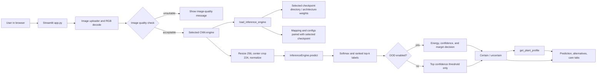
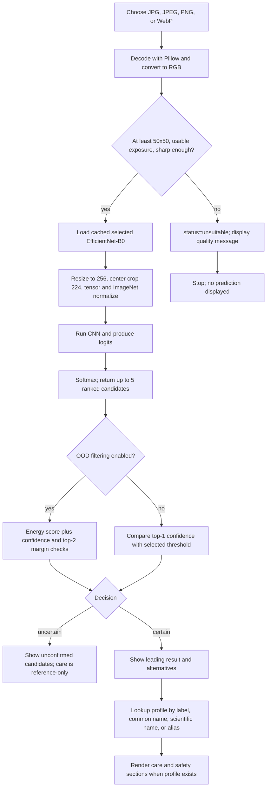
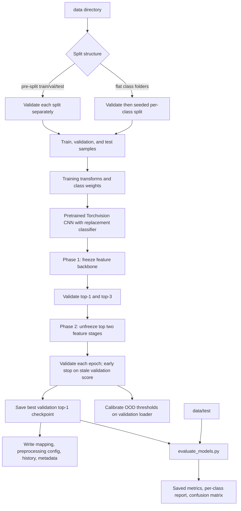

# FloraSense AI: Project Documentation

**Document scope:** This guide describes the redesigned Streamlit interface, the default 47-class EfficientNet-B0, and the preserved 19-class EfficientNet-B0 fallback, alongside the completed training/evaluation artifacts. The previous scikit-learn `_cython_blas` Application Control error did not reproduce during evaluation; no security policy or package changes were made. The exact cause of the earlier denial remains undetermined.

## 1. Project Overview

### Purpose

FloraSense AI is a local plant-photo classification and care-reference application. A user selects a photo, the application screens it for basic image quality, and a trained image classifier returns ranked plant candidates. When the result is considered sufficiently certain, the app can show a care profile from the local `plant_data.py` database.

### Problem and motivation

Indoor plant identification can be difficult for people who do not know botanical terminology. Visual search alone can also return inconsistent results, and care guidance is spread across different sources. This project combines a constrained image classifier with a local species-to-care lookup in one demonstration application.

### Objectives

- Provide a browser-based interface for identifying a limited set of indoor plant labels.
- Preserve model class indices by loading the checkpoint together with its class mapping.
- Screen photos for minimum size, exposure, and blur before classification.
- Expose an uncertainty path instead of presenting every top-ranked class as certain.
- Present locally stored plant-care information after identification or in a separate care browser.
- Provide training, evaluation, API, and test code for experimentation and review.

### Intended users and scope

The interface is suitable for students, project reviewers, and indoor-plant owners. The default `checkpoints_47/` EfficientNet-B0 has a 47-label mapping; the original `checkpoints/` EfficientNet-B0 retains its separate 19-label mapping and is selectable as a fallback. The classifier is not a general botanical identifier, plant-disease diagnostic system, or veterinary/medical resource.

### Current UI features

The root Streamlit app has Home, Identify Plant, Plant Care, Supported Plants, Model Performance, Model Information, and About Project sections. The Home view reports facts from the selected model mapping and matching evaluation report when available. The identification view accepts JPG/JPEG, PNG, and WebP files, shows a preview, returns a primary candidate and top alternatives, retains uncertainty handling, and can display matching care notes. Supported Plants can be searched by mapped, common, or scientific name. Model Performance presents the selected checkpoint's saved offline evaluation report, per-class precision/recall, and confusion matrix when the matching artifacts are available. Model Information shows the paired preprocessing and training metadata.

EfficientNet-B0 · 47 classes is the default; the original EfficientNet-B0 · 19 classes remains available as a fallback. Checkpoints are shown only when their architecture output and class mapping pass the loader's compatibility checks. The currently incompatible MobileNetV3-Small file remains on disk for diagnostics but is not offered in the normal selector. Dataset directories are retained for training and evaluation but are not read for normal inference.

### Active model labels

The original 19-class checkpoint mapping contains these labels:

African Violet, Aloe Vera, Areca Palm, Boston Fern, Calathea, Chinese Evergreen, Dracaena, English Ivy, Jade Plant, Monstera Deliciosa, Orchid, Peace Lily, Pothos, Prayer Plant, Rubber Plant, Snake Plant, Tradescantia, Venus Flytrap, and ZZ Plant.

The local source archive contains a distinct Rattlesnake Plant folder with 316 candidate images. This archive-level audit found no exact decoded-pixel duplicate groups across its images. The older 19-class prepared tree and checkpoint remain unchanged; do not conflate their manifests with the new archive audit.

## 2. Problem Statement and Proposed Solution

Manual identification requires familiarity with leaf shape, venation, growth habit, flowers, and botanical naming. Many houseplants share similar foliage, and a photo can be blurry, poorly exposed, cropped, or show an unusual growth stage. Care needs also vary by species and by indoor conditions.

FloraSense provides a limited, learned image classifier and a local care database. The classifier produces a ranked list rather than a textual explanation of plant biology. A separate quality and confidence/OOD path can mark inputs unsuitable or uncertain. The care database supplies reference guidance only; the software does not examine symptoms, soil, watering history, or environmental sensor readings.

### Assumptions and limitations

- The photo depicts one plant and has enough visible foliage for the model to use.
- The correct plant, if supported, is one of the selected checkpoint's mapped labels.
- Dataset labels are useful but not guaranteed botanically correct.
- A high model score is not a guarantee of correctness.
- Similar-looking foliage can be confused. In the saved report, Pothos is a particularly weak class.
- Care and toxicity notes are static text. The application does not verify them against current external sources at runtime.
- The local dataset has possible near-duplicate split leakage; see [Dataset documentation](#8-dataset-documentation).

## 3. Technology Stack

| Technology | Repository use | Notes |
|---|---|---|
| Python | Application, model, data, API, and test code | The configured workspace virtual environment is Python 3.13.9. The repository does not declare a `requires-python` range. |
| Streamlit | Main user interface in `app.py` | Sidebar navigation, image upload, state, widgets, tabs, and cached model loading. |
| CSS and Streamlit theme | `styles.css`, `.streamlit/config.toml` | Local cream, forest-green, sage, and coral palette with serif headings, responsive layout, and no downloaded fonts or UI dependency. |
| PyTorch | Checkpoint loading, tensor operations, model inference, and training | Training uses CUDA if available unless `--force_cpu` is supplied. Inference selects CUDA if available, otherwise CPU. |
| Torchvision | EfficientNet-B0 and MobileNetV3-Small builders and image transforms | Training requests the library's default pretrained weights; inference builds the architecture without downloading pretrained weights and then loads the local checkpoint. |
| Pillow | Image decoding, verification, conversion, and normalization inputs | The Streamlit app converts uploads to RGB before screening/inference. |
| NumPy | Image-quality calculations and evaluation aggregation | Used in the OOD image-quality and metric code. |
| scikit-learn | Classification report and confusion matrix | Used by `evaluate_models.py`; macro and weighted averages are reported. |
| Matplotlib / Seaborn | Evaluation plots | Confusion matrices and training/validation curves. |
| FastAPI / Uvicorn / Pydantic | Optional REST service in `backend/api.py` | Separate from the Streamlit interface. |
| requests / Pillow | GBIF candidate image collector | `collect_gbif_images.py` requests occurrence records and licensed media. |
| Transformers / timm / datasets / safetensors | Optional ViT and Hugging Face paths | These packages are listed in `requirements.txt`; they are not required by the root Streamlit CNN inference path itself. |
| pytest | Unit tests in `tests/` | Full suite contains 46 passing tests in the latest recorded verification; run the command in this guide to validate the current checkout. |

### Observed local environment

At inspection, the configured `.venv` used Python 3.13.9. The app redesign and smoke checks ran in that environment. `requirements.txt` specifies version ranges rather than an exact lockfile, so another installation may resolve different compatible versions.

## 4. Project Structure

The following tree describes the project root and omits individual image files, virtual-environment internals, and cache contents. The existing `data/` and `checkpoints/` remain the 19-class assets. The completed 47-class dataset and model are separate under `data_47/` and `checkpoints_47/`. The app defaults to the 47-class model and retains the compatible legacy EfficientNet model as its only fallback option.

```text
FloraSense-AI (1)/                  Active project root
|-- app.py                         Streamlit UI and page routing
|-- styles.css                     Botanical UI styling and responsive layout
|-- .streamlit/
|   `-- config.toml                Streamlit palette and heading font
|-- model.py                       CNN checkpoint loader and inference engine
|-- preprocessing/                 Shared image transforms for training and evaluation/inference
|   |-- __init__.py
|   `-- image_preprocessing.py
|-- dataset.py                     Taxonomy, dataset loading, splits, and weighting
|-- prepare_all_classes.py         Read-only archive audit and stratified class preparation
|-- ood_detector.py                Image screening and confidence/OOD decisions
|-- plant_data.py                  Plant profiles, aliases, and care lookup
|-- train_models.py                EfficientNet/MobileNet training pipeline
|-- evaluate_models.py             CNN checkpoint evaluation and plots
|-- train.py                       Separate ViT training path
|-- evaluate.py                    Separate ViT evaluator; root import is not verified
|-- download_real_dataset.py        Hugging Face archive preparation script
|-- collect_gbif_images.py          GBIF licensed-media candidate collector
|-- audit_dataset.py                Read-only image-tree audit utility
|-- backend/
|   `-- api.py                     Optional FastAPI endpoints
|-- checkpoints/
|   |-- efficientnet_b0_best.pt    Preserved 19-class EfficientNet fallback
|   |-- mobilenet_v3_small_best.pt Incompatible; retained for diagnostics only
|   |-- class_mapping.json         Mapping for checkpoints in this directory
|   |-- preprocessing_config.json  Matching input preprocessing configuration
|   |-- ood_thresholds.json        Matching OOD calibration metadata
|   |-- training_metadata.json     EfficientNet production-run metadata
|   |-- efficientnet_b0_history.json
|   `-- mobilenet_v3_small_history.json
|-- data/
|   |-- train/<19 class folders>/  4,616 images in the saved audit
|   |-- val/<19 class folders>/    977 images
|   |-- test/<19 class folders>/   977 images
|   `-- dataset_manifest.json     Prepared-data manifest, claims archive source/license
|-- data_47/                       New 47-class split destination; created by preparation
|-- checkpoints_47/                47-class EfficientNet-B0 and matching artifacts/report
|-- data_gbif_smoke/               30 GBIF candidate images; pending review
|   `-- source_manifest.json
|-- data_gbif_staging/             Partial GBIF collection; not used by training
|   `-- source_manifest.json       Incomplete relative to files currently in folders
|-- saved_models/florasense_vit/   Separate 47-label ViT artifact/configuration
|-- tests/
|   |-- test_dataset.py
|   |-- test_model.py
|   |-- test_ood_detector.py
|   |-- test_plant_data.py
|   `-- conftest.py
|-- FloraSense_Colab_Training.ipynb
|-- requirements.txt
|-- .env.example
|-- README.md
|-- evaluation_report.json         Saved legacy 19-class evaluation results
|-- dataset_audit_report.json      Saved audit report for `data/`
|-- dataset_manifest.json          Optional synthetic demo manifest; generated by demo code
|-- gbif_candidate_inventory.json  Occurrence-record inventory, not image counts
|-- house_plant_species.tar        Local source archive (5.27 GB)
|-- efficientnet_b0_confusion_matrix.png
|-- confusion_matrix.png           Generic/ViT evaluator artifact name
|-- model_comparison_confusion_matrix.png
|-- training_validation_curves.png
`-- .venv/ and caches              Environment and regenerable runtime files
```

### Important module relationships

- `app.py` imports `model.py`, `ood_detector.py`, and `plant_data.py`. It loads class names from the selected checkpoint's `class_mapping.json`, reads that checkpoint's matching evaluation report and metadata when present, and uses `styles.css` plus `.streamlit/config.toml` for presentation.
- `model.py` imports `build_model` from `train_models.py` at engine initialization, loads a checkpoint and the adjacent class mapping, then returns ranked predictions.
- `train_models.py` uses `dataset.py` for loading, weights, splits, and mappings; `preprocessing/` supplies training and validation transforms; `ood_detector.py` calibrates thresholds.
- `dataset.py`, `train_models.py`, and `model.py` use the shared `preprocessing/` module. Training receives random augmentation; validation, testing, and inference use deterministic preprocessing.
- `evaluate_models.py` loads `model.py` checkpoints and real test images using `dataset.py`, and writes JSON/plot artifacts.
- `backend/api.py` separately exposes health, species, care, and image-identification routes using the same model/data modules.
- `tests/` covers data helpers, model loading, image screening/OOD decisions, and care profiles. It does not automate browser navigation.

### Active, optional, and unverified paths

The active demonstration is the root `app.py` with EfficientNet-B0 · 47 classes by default and EfficientNet-B0 · 19 classes as a selectable fallback. The legacy MobileNetV3-Small checkpoint fails its output-size/class-mapping compatibility check; MobileNet options are excluded from the normal selector but remain visible in Advanced Settings diagnostics. A MobileNet 47-class checkpoint is unavailable. The root `train.py` is a Transformers ViT trainer, distinct from `train_models.py`. The root `evaluate.py` imports `PlantClassifier`, which is not defined in the root `model.py`; its compatibility with the root project is therefore not verified and it is expected to fail at import unless the appropriate alternate model implementation is used.

### Streamlit presentation and model selection

- The interface uses the existing local CSS, with the Streamlit theme in `.streamlit/config.toml`: warm cream surfaces, forest-green controls/headings, sage panels, restrained coral accents, serif headings, and responsive spacing. No font or external UI asset is downloaded.
- The model selector offers concise names (`EfficientNet-B0 · 47 classes` and `EfficientNet-B0 · 19 classes`). The 47-class checkpoint is the default. The class list, output dimensions, and care lookup use the currently selected mapping rather than a fixed class count.
- Checkpoint diagnostics and OOD sliders are inside **Advanced settings**. Energy, confidence, margin, and temperature values load from the selected checkpoint's OOD configuration. Widget state is separated by checkpoint, and a model switch clears any result produced using the previous mapping.
- Model engines are cached as Streamlit resources and keyed by checkpoint identity/signature; checkpoint diagnostics and JSON artifacts are cached with their file signatures. This avoids repeated loads in ordinary reruns while allowing a changed checkpoint artifact to be reloaded.
- **Model Performance** reads saved, checkpoint-matched evaluation data only. The 47-class report and confusion-matrix image are under `checkpoints_47/`. The 19-class report is at the project root; it is used only with the 19-class mapping after its reported class labels are checked against that mapping. Missing or mismatched report data is not presented as metrics for the selected model.
- The 47-class dashboard reports 76.84% top-1, 90.99% top-3, 76.21% macro-F1, and 76.73% weighted-F1 on 2,198 held-out test images. The legacy 19-class dashboard uses its saved report for 977 test images. These are offline test metrics, not confidence values for a user's uploaded image.
- Prepared datasets are not read for ordinary inference. They remain in the workspace for training and evaluation; no datasets, checkpoints, or reports were removed or relocated during the UI redesign.

## 5. System Architecture



The root application also has a separate optional FastAPI service. It is not a network backend used by Streamlit; the Streamlit app directly loads the local checkpoint. Plant profiles are looked up from Python dictionaries in `plant_data.py`.

## 6. End-to-End Image Identification Workflow



The exact thresholds can be changed in the sidebar. When OOD is on, `calibrate_and_filter` marks a result uncertain if its energy is below the threshold or if confidence/margin checks fail. When OOD is off, the Streamlit path only checks the top prediction's confidence. The separate OOD helper also supports an `unsuitable` decision for an empty candidate list, but the UI's image-quality failure is handled before model inference.

Each selected checkpoint uses its own `ood_thresholds.json` values for energy, confidence, margin, and temperature. The sliders initialize from those values; the temperature is also read from the selected configuration. A new model's thresholds are calibrated from its validation data only after reloading the best validation checkpoint. These heuristic thresholds are not a guarantee of calibrated confidence or OOD detection.

## 7. Machine-Learning Model

### CNN and EfficientNet-B0

A convolutional neural network (CNN) applies learned filters across local image regions to build increasingly abstract feature representations. Early layers respond to edges, colors, and textures; deeper layers combine them into higher-level shapes and patterns. EfficientNet is a family of convolutional architectures designed around scaling depth, width, and input resolution. This project uses Torchvision's `efficientnet_b0` builder rather than implementing the architecture itself.

EfficientNet-B0 is the only currently selectable CNN architecture. The saved legacy evaluation report lists approximately 4.03 million parameters and 24.48 MB checkpoint size. The app defaults to the separately trained 47-class EfficientNet-B0; its 19-class counterpart remains selectable as a fallback. MobileNetV3-Small remains in training utilities and on disk, but the found 19-class checkpoint is incompatible with its class mapping and is not selectable.

### Transfer learning as implemented

`train_models.py` calls Torchvision's default pretrained weights for the selected CNN, replaces the classifier head with a project-specific output layer, and trains in two phases:

1. **Head warmup:** freeze the `features` backbone and train the classifier.
2. **Fine-tuning:** unfreeze the top two `features` stages and optimize backbone and head groups at different learning rates.

This differs from training from scratch: transfer learning starts from features learned on a large earlier dataset, then adapts the classifier and selected layers to plant images. Inference builds the same architecture with `pretrained=False` and loads the local trained state dictionary.

### Implemented training settings

| Setting | Source-code default / behavior |
|---|---|
| Architecture | EfficientNet-B0 is selected by the app; the training pipeline also supports `mobilenet_v3_small` |
| Input | 224 x 224 model crop; resize to 256 before center crop for validation/inference |
| Shared implementation | `preprocessing/image_preprocessing.py`, re-exported by `preprocessing/__init__.py` |
| Training augmentation | Random resized crop (scale 0.75-1.0, ratio 0.85-1.15), horizontal flip, rotation up to 15 degrees, color jitter 0.15 |
| Validation/test/inference transform | Deterministic resize to 256 with bilinear interpolation, center crop to 224, tensor conversion, ImageNet mean/std normalization |
| ImageNet normalization | Mean `[0.485, 0.456, 0.406]`; std `[0.229, 0.224, 0.225]` |
| Loss | Weighted cross-entropy; inverse-frequency class weights normalized to mean 1 |
| Optimizer | AdamW, weight decay `1e-4` |
| Default learning rates | Head `5e-4`; backbone `1e-5`; fine-tuning head group uses half the head LR |
| Batch size | 32 |
| Epochs | 5 warmup + 15 fine-tuning by CLI defaults |
| Scheduler | Cosine annealing per phase |
| Early stopping | Patience 5, after at least 3 epochs in a phase |
| Gradient clipping | Norm 1.0 |
| Seed | 42 by default; CUDA/CuDNN deterministic flag set |
| Minimum class count | 10 by default, reported as a deficiency rather than silently balancing with synthetic data |

### Training and evaluation workflow



For a prepared dataset, `create_real_splits()` detects the already-separated directories and loads them. One sorted folder-name mapping is used for all splits. Exact duplicate copies across splits are excluded (preferring test, then validation, then train); label-conflicting pixel duplicates are excluded entirely. Training uses only training and validation samples; the evaluator reads the held-out test tree. The split code does not group by source identity or detect perceptual near-duplicates, so full leakage-free independence is not established.

These are the current script defaults. The exact hyperparameters used to create the currently installed production checkpoint are **not verified**: `training_metadata.json` marks the run production but omits warmup/fine-tune epochs; `efficientnet_b0_history.json` contains only one epoch in each phase and a `best_acc` of 0.0833, inconsistent with checkpoint metadata's validation top-1 of about 0.8025. Treat the history as a possibly stale artifact, not proof of this checkpoint's training trajectory.

### Checkpoint and class mapping

The app offers the two usable EfficientNet checkpoints. For either selection, it loads the adjacent `class_mapping.json`, validates classifier output dimensions against the checkpoint, and displays only labels from that mapping. The original mapping has 19 classes and the new mapping has 47. Both use 224 crop/input size, 256 resize size, bilinear interpolation, and ImageNet mean/std values recorded in their checkpoint directories' `preprocessing_config.json`. The class mapping, preprocessing configuration, weights, and OOD thresholds must remain paired. Runtime transforms come from `preprocessing/image_preprocessing.py`.

The active checkpoint SHA-256 observed on 2026-10-18 is:

```text
AE9AC1A0491538771C7D2660D5BA863B54B901775B8B50245578558B11CBEF8A
```

Do not copy a checkpoint without its matching `class_mapping.json`; changed class order would change the meaning of prediction indices.

## 8. Dataset Documentation

### Active training/evaluation data

`checkpoints/training_metadata.json` records `data_dir: ./data`, `is_demo_run: false`, and `status: trained_production` for EfficientNet-B0. `data/dataset_manifest.json` identifies `kakasher/house-plant-species`, claims CC BY 3.0, warns that images came from Bing Images and non-expert curation, and records 6,570 processed images. The legacy prepared tree and checkpoint do not contain Rattlesnake Plant. The archive-level scan, however, found a distinct 316-image folder for it; the legacy manifest's duplicate statement is not consistent with that full-source scan. Per-image origin/licensing records are unavailable.

The current `data/` tree has 19 class directories per split. Audited image totals:

| Class | Train | Validation | Test | Total |
|---|---:|---:|---:|---:|
| African Violet | 237 | 50 | 50 | 337 |
| Aloe Vera | 177 | 37 | 37 | 251 |
| Areca Palm | 133 | 28 | 28 | 189 |
| Boston Fern | 216 | 45 | 45 | 306 |
| Calathea | 453 | 96 | 96 | 645 |
| Chinese Evergreen | 360 | 77 | 77 | 514 |
| Dracaena | 183 | 39 | 39 | 261 |
| English Ivy | 168 | 36 | 36 | 240 |
| Jade Plant | 249 | 52 | 52 | 353 |
| Monstera Deliciosa | 383 | 82 | 82 | 547 |
| Orchid | 164 | 35 | 35 | 234 |
| Peace Lily | 271 | 57 | 57 | 385 |
| Pothos | 171 | 36 | 36 | 243 |
| Prayer Plant | 280 | 60 | 60 | 400 |
| Rubber Plant | 205 | 43 | 43 | 291 |
| Snake Plant | 278 | 59 | 59 | 396 |
| Tradescantia | 239 | 51 | 51 | 341 |
| Venus Flytrap | 141 | 29 | 29 | 199 |
| ZZ Plant | 308 | 65 | 65 | 438 |
| **Total** | **4,616** | **977** | **977** | **6,570** |

The total split is approximately 70.3% train / 14.9% validation / 14.9% test. Areca Palm is the smallest class (189); Calathea is the largest (645), a maximum-to-minimum ratio of 3.413. Neither the active dataset nor model mapping contains a separate Rattlesnake Plant class.

### Cleaning, augmentation, and duplicate limitations

- `download_real_dataset.py` is the older selected-class utility. The new `prepare_all_classes.py` reads the source TAR without extracting it, discovers raw class-folder names, verifies image decoding and dimensions (minimum 50 x 50), computes exact hashes of decoded RGB pixels, excludes duplicate files and conflicting-label copies, and writes seeded stratified train/validation/test folders to a separate output path.
- The older downloader's `SELECTED_CLASSES` mapping contains 32 candidate labels. Its `--add_class` option skips exact duplicates across existing splits and refuses to add a class if too few unique images remain. Do not interpret that legacy selected-class result as a complete scan of the local source TAR. The default full preparation mode can overwrite classes in its target `--data_dir`.
- `dataset.py` verifies files, hashes decoded RGB pixels, excludes same-label duplicates, removes all copies of cross-label duplicates, and uses one shared mapping for pre-split folders. Cross-split duplicates are excluded with test prioritized over validation and train. Near-duplicate/source-identity leakage is not assessed.
- `audit_dataset.py` reports zero corrupt images, zero exact SHA-256 duplicate groups, 35 heuristic quality warnings, 1,653 near-duplicate pairs at average-hash distance <= 3, and 807 possible near-duplicate cross-split pairs. Near-duplicate flags are candidates for review, not confirmed identical images.
- `check_image_quality()` rejects dimensions below 50 x 50 in code. Its user-facing error text asks for at least 224 x 224, so the actual threshold and wording differ.
- The training transform performs random crop, horizontal flip, rotation, and color jitter. These are online tensor transforms; they do not create saved synthetic training images.
- There is no verified file-level source identity or same-source grouping in the active `data/` manifest. The same-source leakage status is therefore **not verified**.

### Dataset source and license limitations

The Hugging Face dataset card states that the data is for personal use only due to copyright considerations, despite a conflicting CC BY 3.0 badge and local metadata. Rights to redistribute or use all underlying images beyond the stated personal-use scope are **not verified**. Obtain permission/clarification before redistribution or non-personal use. The archive is present locally at `house_plant_species.tar` (about 5.27 GB); its presence does not prove legal rights.

### 47-class archive verification and preparation

The local TAR audit discovered 47 actual class folders and 14,790 image files. All 14,790 decoded successfully and met the preparation script's 50 x 50 minimum; exact decoded-RGB hashing found zero duplicate groups. Class counts ranged from 66 Yucca images to 547 Monstera Deliciosa images. These are archive scan facts, not model results. The scan did not test perceptual/near-duplicate similarity or image provenance.

To prepare a separate stratified dataset without modifying the legacy `data/` tree:

```powershell
python prepare_all_classes.py --archive .\house_plant_species.tar --output_dir .\data_47 --expected_classes 47 --min_images_per_class 10
```

This command writes an audit report and split manifest under `data_47/`, refuses a non-empty destination, and prints per-class counts plus invalid/duplicate entries. Inspect the resulting reports before training. The retained folder names are the dataset's raw labels; one shared sorted mapping is then used across all splits. Exact duplicate copies across splits are excluded, with held-out test copies preferred. Image-source grouping and perceptual duplicates remain unresolved.

### GBIF candidate data is not training data

- `data_gbif_smoke/` holds 30 images across 15 candidate species, with two images per species. Its `source_manifest.json` marks label and suitability review as pending.
- `data_gbif_staging/` currently contains 213 image files, but its manifest records only the Anthurium collection (94 manifest rows). A Birds Nest Fern folder and other small remnants do not have matching complete provenance entries. Do not use this staging tree for training without reconciling files and manifests.
- `gbif_candidate_inventory.json` counts license-filtered **occurrence records**, not image files or human-verified usable images.
- `collect_gbif_images.py` resolves exact GBIF species matches, requests occurrence records with still-image media, accepts per-media CC0 1.0 or CC BY 4.0, records attribution/license/source fields, rejects invalid or small images and exact duplicates in its output tree, and labels all images pending human review. The record count does not validate the photo's label.
- Neither GBIF folder is referenced by the production training metadata (`./data`). They are candidate/review material only.

### Root vs data manifest

`data/dataset_manifest.json` describes the prepared real-image tree. The optional root `dataset_manifest.json` is written by `create_synthetic_demo_splits()` and records 20 taxonomy labels with synthetic 40/20/20 train/validation/test sizes and 15 OOD images. It is demo metadata, not the active real dataset report, and can be deleted and regenerated by the demo helper or tests.

## 9. Plant-Care Information

`plant_data.py` defines Python dictionaries containing common/scientific names, family, descriptions, plant type, maintenance, location, sunlight, water, soil, temperature/humidity, pruning, features, toxicity/safety text, and sometimes references/aliases. `get_plant_profile()` uses exact keys, normalized names, scientific/common names, and aliases. It avoids ambiguous substring matching; unknown labels return no profile and the UI displays an explicit fallback.

The root Streamlit app requests a profile using the selected label or predicted common name. Care is shown fully for a `certain` result. For an `uncertain` result, the app labels the profile as an unconfirmed reference. Missing fields display an unavailable message. Toxicity text comes from the local profile; it is not queried from ASPCA or another service at runtime.

The module comments describe the profiles as cross-referenced with Kew POWO and RHS and some entries contain explicit source strings. Individual profile facts and every toxicity claim have **not** been independently revalidated for this documentation. The interface includes a safety disclaimer; it is not medical or veterinary advice.

## 10. Evaluation and Existing Results

`evaluate_models.py` evaluates available CNN checkpoints on `./data/test`, if present. It loads each engine, computes top-1/top-3 accuracy, `classification_report` per-class precision/recall/F1/support, confusion matrices, latency and parameter counts. It applies the saved OOD thresholds to test samples and counts uncertain decisions as false rejections. It writes `evaluation_report.json`, architecture confusion matrices such as `efficientnet_b0_confusion_matrix.png`, and `training_validation_curves.png` when history data exists.

The existing root `evaluation_report.json` contains EfficientNet-B0 results on **977 held-out test images** from the legacy 19-class dataset. Separately, `checkpoints_47/evaluation_report.json` contains the new 47-class evaluation on **2,198 held-out test images**. The evaluator completed on CPU; test data was not used in training, model selection, or OOD calibration.

| 47-class EfficientNet-B0 metric | Test result |
|---|---:|
| Top-1 accuracy | 76.84% |
| Top-3 accuracy | 90.99% |
| Macro-F1 | 76.21% |
| Weighted-F1 | 76.73% |
| Test images | 2,198 |
| Classes | 47 |

The JSON report stores each class's precision, recall, F1, and support, along with the full labeled 47 x 47 confusion matrix. The corresponding plot is `checkpoints_47/efficientnet_b0_confusion_matrix.png`. The legacy 19-class checkpoint SHA-256 is unchanged.

| Metric | Existing report |
|---|---:|
| Top-1 accuracy | 81.88% |
| Top-3 accuracy | 94.58% |
| Macro-F1 | 81.49% |
| Weighted-F1 | 81.67% |
| Recorded inference latency | 21.17 ms/image |
| Parameter count | 4.03 million |
| Checkpoint size | 24.48 MB in the report |
| Uncertain/false-rejection rate | 14.23% |
| False-acceptance rate | `null` / not reported |
| Test support | 977 |

Top-1 accuracy is the fraction whose highest-scoring label matches the test label. Top-3 counts a correct label among the first three. Precision is the fraction of a predicted class's positive predictions that are correct; recall is the fraction of the true class recovered; F1 is their harmonic mean. Macro-F1 averages class F1 values equally, so small classes count as much as large classes. Weighted-F1 weights each class by support. The confusion matrix counts true-vs-predicted labels.

Per-class values copied from the existing classification report:

| Class | Precision | Recall | F1 | Test images |
|---|---:|---:|---:|---:|
| African Violet | 97.8% | 88.0% | 92.6% | 50 |
| Aloe Vera | 81.6% | 83.8% | 82.7% | 37 |
| Areca Palm | 73.5% | 89.3% | 80.6% | 28 |
| Boston Fern | 93.0% | 88.9% | 90.9% | 45 |
| Calathea | 84.8% | 81.3% | 83.0% | 96 |
| Chinese Evergreen | 78.7% | 76.6% | 77.6% | 77 |
| Dracaena | 59.6% | 87.2% | 70.8% | 39 |
| English Ivy | 85.3% | 80.6% | 82.9% | 36 |
| Jade Plant | 77.4% | 92.3% | 84.2% | 52 |
| Monstera Deliciosa | 81.2% | 84.1% | 82.6% | 82 |
| Orchid | 85.0% | 97.1% | 90.7% | 35 |
| Peace Lily | 86.0% | 64.9% | 74.0% | 57 |
| Pothos | 68.4% | 36.1% | 47.3% | 36 |
| Prayer Plant | 78.8% | 86.7% | 82.5% | 60 |
| Rubber Plant | 88.1% | 86.0% | 87.1% | 43 |
| Snake Plant | 88.7% | 79.7% | 83.9% | 59 |
| Tradescantia | 72.3% | 92.2% | 81.0% | 51 |
| Venus Flytrap | 100.0% | 82.8% | 90.6% | 29 |
| ZZ Plant | 86.7% | 80.0% | 83.2% | 65 |

These are historical saved values, not guaranteed future behavior. Test-set images may be correlated with training sources; the dataset audit flags possible near-duplicate leakage. Pothos recall/F1 is low in the report. `false_acceptance_rate_pct` is `null`; the evaluator has an `ood_dir` argument, but the inspected evaluation loop does not consume that directory or calculate false acceptance on a separate OOD set. No MobileNet metrics are in this report.

The prepared 47-class dataset contains 14,790 images (10,394 train / 2,198 validation / 2,198 test). A CPU-only run completed 2 warmup epochs and 3 fine-tuning epochs using cached pretrained EfficientNet-B0 weights and batch size 8. The best checkpoint reached **77.93% validation top-1** and **91.13% validation top-3**. OOD thresholds were calibrated on the 2,198 validation samples after loading the best validation checkpoint. The test set was not used for training, model selection, or calibration. The evaluator then completed successfully. An earlier attempt had been denied by Windows Application Control when importing scikit-learn's `_cython_blas`; the denial did not recur, and no security control or package was changed to achieve the successful run.

The JSON report does not record the device used for its latency measurement; the evaluator measures on the device selected by `InferenceEngine`. The hardware used for that timing is therefore **not verified in the report**.

The root `evaluate.py` is a separate ViT evaluator that imports `PlantClassifier`; that class is absent in the root `model.py`. It is not the CNN evaluator and is not verified as runnable from the root project.

## 11. Testing and Quality Assurance

| Test file | Main checks |
|---|---|
| `tests/test_dataset.py` | Archive class discovery, stratified splits, shared labels, duplicate exclusion, transforms, class weights, and synthetic smoke split |
| `tests/test_model.py` | Checkpoint compatibility, dynamic output size, prediction label/index mapping, missing checkpoint behavior, species metadata aliases |
| `tests/test_ood_detector.py` | Image quality accept/reject, energy/confidence/margin calibration, and uncertainty decisions |
| `tests/test_plant_data.py` | Care profile lookups, toxic/safe text, separation of Snake Plant/Rattlesnake Plant, profile coverage |
| `tests/conftest.py` | Textured synthetic image fixture and checkpoint directory fixture |

The expanded suite includes archive class discovery, shared labels, duplicate exclusion, 47-output checkpoint compatibility, prediction labels, and OOD threshold calibration. The full suite passed with **46 tests** during the UI redesign validation. The 47-class inference smoke check also loaded the production checkpoint, emitted 47 logits, and returned three labels from the mapped taxonomy; this confirms basic loading and output shape, not classification accuracy. The browser check confirmed the 47-class default, both EfficientNet options, searchable class filtering, model-specific saved metrics, and the incompatible MobileNet diagnostic. Some tests use generated images for code-path checks; these are not training images or model-accuracy evidence.

## 12. Setup and Execution Guide

Commands below are for Windows PowerShell from the project root. This workspace already has `.venv`; do not recreate it if preserving the current environment.

### Create and activate a new environment

```powershell
Set-Location "C:\Users\Hp\Downloads\FloraSense-AI (1)"
py -3.13 -m venv .venv
.\.venv\Scripts\Activate.ps1
python -m pip install --upgrade pip
python -m pip install -r requirements.txt
```

If the Python launcher is unavailable, install a compatible Python runtime first. The repository does not pin an exact interpreter version; the inspected workspace used Python 3.13.9.

### Environment configuration

`.env.example` is a reference template; the project does not load it with `python-dotenv`. The optional API reads `FLORASENSE_CHECKPOINT_DIR` from the process environment; other sample names should not be assumed to configure the app. For the 47-class checkpoint, set `$env:FLORASENSE_CHECKPOINT_DIR = ".\checkpoints_47"` in PowerShell before starting Uvicorn. No API key is required by local inference.

### Start the app

```powershell
python -m streamlit run app.py
```

Open `http://localhost:8501`. If `python` is not the configured project environment, use:

```powershell
& ".\.venv\Scripts\python.exe" -m streamlit run app.py
```

### Tests, audit, and evaluation

```powershell
python -m pytest tests -q
python audit_dataset.py --data_dir ./data --output dataset_audit_report.json
python evaluate_models.py --checkpoint_dir ./checkpoints --test_dir ./data/test --output evaluation_report.json
```

`audit_dataset.py` writes a JSON report; it does not alter images. Evaluation writes report/plot files and therefore may replace existing outputs.

### Prepare and train the 47-class pipeline (optional)

The existing 19-class `data/` and `checkpoints/` are not modified. In this workspace, the archive has already been prepared under `data_47/`; skip the preparation command unless beginning with an empty output directory (the script refuses to overwrite a non-empty destination). Train and evaluate into the separate directories:

```powershell
python prepare_all_classes.py --archive .\house_plant_species.tar --output_dir .\data_47 --expected_classes 47 --min_images_per_class 10
python train_models.py --arch efficientnet_b0 --data_dir .\data_47 --checkpoint_dir .\checkpoints_47 --warmup_epochs 2 --finetune_epochs 3 --batch_size 8 --patience 2 --force_cpu
python evaluate_models.py --checkpoint_dir .\checkpoints_47 --test_dir .\data_47\test --output .\checkpoints_47\evaluation_report.json
```

Training uses validation data for best-checkpoint selection and OOD calibration; the test split is reserved for evaluation. The local environment has CPU-only PyTorch, so training can take substantial time; append `--force_cpu` to make the device choice explicit. Do not run `--demo` against either real checkpoint directory: demo mode writes mapping/config/history and may save checkpoint weights there. Review the archive's personal-use terms before use outside permitted local personal use.

### Dataset/download utilities

The archive script's implemented command is:

```powershell
python download_real_dataset.py --data_dir ./data --min_images 50
```

It downloads/extracts a Hugging Face archive and writes train/validation/test folders. This archive's usage rights are unresolved as explained above. Back up real data and use a separate `--data_dir` before experimenting.

GBIF candidate inspection/collection commands are:

```powershell
python collect_gbif_images.py --inventory-only --inventory-output gbif_candidate_inventory.json
python collect_gbif_images.py --output-dir ./data_gbif_staging --target-images 500 --max-records 100000
```

The inventory reports occurrence-record counts, not usable image counts. Collected images are staged with pending review and must not be used as training data without reconciling their source manifest and human-verifying labels.

### Optional FastAPI service

```powershell
python -m uvicorn backend.api:app --host 127.0.0.1 --port 8000
```

The interactive API description is normally at `http://127.0.0.1:8000/docs`. This service is separate from Streamlit.

### Google Colab

`FloraSense_Colab_Training.ipynb` is an intended GPU workflow with dependency installation, repository clone, data preparation, EfficientNet/MobileNet training, evaluation, and checkpoint packaging. The notebook summary reports that none of its cells have been executed. Its clone URL is a `YOUR_USERNAME` placeholder, and it repeats the dataset-license claim that conflicts with the current card. It is therefore a template, not a verified end-to-end Colab run. Before using it, set a real repository URL and resolve dataset permissions. Select Runtime > Change runtime type > GPU, then run cells in order only after reviewing the cells that download data and write checkpoints.

## 13. Design Decisions and Security

- The Streamlit interface loads the model locally and describes uploads as local processing; it does not send images to a cloud inference API.
- `st.cache_resource` caches the selected model engine; the cache key includes checkpoint signature inputs. Checkpoint availability scans and JSON artifacts are also cached against file signatures.
- Inference uses the selected checkpoint's paired mapping, preprocessing configuration, and OOD thresholds. Switching checkpoints clears stale prediction state and uses checkpoint-specific OOD widget keys.
- The 47-class EfficientNet is the default. Only the compatible 19-class EfficientNet is selectable as fallback; incompatible MobileNet files are diagnostics-only and are not deleted.
- Evaluation results shown in the app are loaded from the saved report paired with the selected mapping. They are not recomputed on app startup and are labeled separately from live per-image confidence.
- Local datasets are retained for retraining/evaluation and are not required by the inference-only Streamlit path. No model weights, source datasets, or evaluation artifacts were changed in this redesign.
- `class_mapping.json` is required next to CNN weights to prevent index/label mismatch.
- The backend has permissive CORS (`allow_origins=["*"]` with credentials enabled). This is not a production security configuration; restrict origins and review authentication before exposing it.
- The backend reads the uploaded body before checking the 10 MB size limit. Do not expose it to untrusted traffic without reviewing upload/resource controls.
- `torch.load` loads local checkpoint files. Only load trusted checkpoints; do not accept model files from untrusted users.
- The `.env.example` file contains no secrets and is not read by current root code. No credentials are required for local inference.
- Dataset copyright and provenance limitations must be resolved before redistribution or broader deployment.
- The care database contains informational pet-safety text. It is not a substitute for veterinary/medical advice.

## 14. Limitations and Future Scope

### Confirmed repository limitations

- The original EfficientNet checkpoint has 19 classes. The separate EfficientNet checkpoint has 47 classes and has a completed held-out evaluation report.
- Real training derives its output class count and mapping from discovered dataset folders. The legacy static taxonomy remains for demo/legacy helpers; it is not the source of the real 47-class mapping.
- The prepared dataset's source attribution is not per-image. The source card's personal-use statement conflicts with the CC BY 3.0 badge and local manifests.
- Exact pixel duplicates are excluded, but same-source and perceptual near-duplicate leakage is not assessed by the new preparation flow.
- `efficientnet_b0_history.json` and production training metadata conflict; training hyperparameters for the installed checkpoint are not established by those artifacts.
- `data_gbif_staging/` is incomplete: 213 images are present but the manifest only records one species' 94 images. GBIF candidates are pending human label/suitability review and are not included in the active training run.
- Root `evaluate.py` refers to `PlantClassifier`, which does not exist in root `model.py`. The nested project copy was removed; the root app is the active project.
- The stored evaluation report provides no false-acceptance metric and no separate OOD set was evaluated by the inspected CNN loop.

### Possible future work (not currently implemented)

- Resolve image rights; add image-level source/licence records to all training data.
- Manually audit candidate labels, remove near-duplicates, and regroup splits by image/source identity before making new accuracy claims.
- Reconcile the taxonomy and metadata resolvers with the actual checkpoint mapping without silently changing class IDs.
- Produce a fresh, reproducible training history that records the exact code/config/data version and checkpoint hash.
- Add a genuinely independent OOD test set and report false acceptance/false rejection separately.
- Repair or retire the separate ViT evaluation path if ViT support remains in scope.
- Add automated Streamlit integration tests and API tests.

## 15. Viva and Guide-Review Preparation

### Short project summary

FloraSense AI is a local Streamlit demonstration that screens an uploaded plant image, classifies it using the selected checkpoint's mapping, applies confidence/OOD handling, and displays local plant-care references when available. The 47-class EfficientNet-B0 is the default, and the preserved 19-class EfficientNet-B0 remains a selectable fallback.

### Demonstration sequence

1. Start `python -m streamlit run app.py` and show the Home dashboard.
2. Open Identify Plant and upload a clear image from the supported test set.
3. Click Identify; discuss the predicted label, existing confidence output, and top alternatives.
4. Explain that an uncertain decision remains unconfirmed and should not be treated as fact.
5. Open the care tabs and point out the source database and safety disclaimer.
6. Open Supported Plants and explain that the displayed class list is loaded from the selected checkpoint mapping.
7. Open Model Performance and explain that the displayed metrics are saved results for the selected checkpoint, not a live benchmark. The 47-class report covers 2,198 held-out test images; the legacy 19-class report covers 977.
8. If asked about the dataset, show the audit caveats and license conflict rather than claiming complete provenance.

### Likely viva questions

1. **What problem does FloraSense address?** It combines a constrained plant image classifier with a local care-reference display to make a project demonstration of identification and care lookup.
2. **What is the model's actual output space?** The selected checkpoint's `class_mapping.json` defines it. The preserved root checkpoint has 19 labels; the new preparation path discovers the 47 archive folder labels.
3. **Why use EfficientNet-B0?** It is the project's primary transfer-learning baseline, implemented through Torchvision, with a compact reported 4.03M-parameter model and measured inference results.
4. **What is transfer learning?** Reusing pretrained visual features and adapting a classifier/backbone to a narrower task, rather than learning all features from random initialization.
5. **What happens before classification?** Pillow decodes and converts the upload to RGB; the OOD helper checks minimum size, average brightness, and Laplacian-variance sharpness.
6. **How is the image transformed for inference?** Resize to 256, center crop to 224, convert to tensor, and normalize using ImageNet mean/std.
7. **What is a class mapping?** A fixed mapping from model output indices to class labels. It must match the checkpoint exactly.
8. **What does confidence mean?** It is the softmax score for a candidate. It is not a calibrated guarantee of correctness for every image.
9. **How is uncertainty determined?** When OOD filtering is enabled, the code checks energy, top confidence, and the gap to the second candidate. When disabled, it still applies the configured top-confidence threshold.
10. **What is the difference between validation and test data?** Validation is used during model development/calibration; test data is intended for final held-out assessment. The existing report uses 977 test images.
11. **What is macro-F1?** The arithmetic mean of per-class F1 scores, giving each class equal weight regardless of sample count.
12. **Why can top-3 accuracy exceed top-1?** A correct class can appear second or third even when the top-ranked class is wrong.
13. **What does the current report say?** It records 81.88% top-1, 94.58% top-3, and 81.49% macro-F1 on 977 held-out images. It is a saved result, not a new evaluation.
14. **Which class is a known weakness?** Pothos has reported recall 36.1% and F1 47.3%, showing difficulty distinguishing visually similar foliage in this dataset.
15. **Are there duplicate or leakage concerns?** The source archive scan found no exact decoded-pixel duplicates, and the preparation tool excludes such duplicates across splits. Perceptual near-duplicates and original-source identity have not been audited.
16. **Was the full archive license verified?** No. The dataset card states personal use only despite a conflicting CC BY badge. Resolve rights before redistribution or non-personal use.
17. **Does the care database diagnose plant disease?** No. It displays species-level reference care and safety text only.
18. **Can the application identify any plant?** No. It is limited to the selected checkpoint's mapped classes; unseen plants may be marked uncertain if filtering is enabled.
19. **Is MobileNet part of the app?** Its files remain available for diagnostics, but the current 19-class MobileNet checkpoint fails its output-size/class-mapping compatibility check and is therefore excluded from model selection.
20. **What is not fully verified?** Exact training hyperparameters for the installed checkpoint, complete image rights, label correctness, same-source split independence, GBIF staging completeness, and the root ViT evaluation path.

## 16. Glossary and References

### Glossary

| Term | Meaning in this project |
|---|---|
| CNN | Convolutional neural network; a model that learns spatial image features using convolution operations. |
| EfficientNet-B0 | The Torchvision CNN architecture used as the primary active classifier. |
| Transfer learning | Reusing pretrained weights and adapting layers/classifier to the plant-label task. |
| Checkpoint | Saved model parameters plus training values, loaded by the inference engine. |
| Class mapping | JSON correspondence between output index and plant label. |
| Preprocessing | Shared image resize/crop/tensor/normalization steps in `preprocessing/`; inference and evaluation omit random augmentation. |
| Augmentation | Random transformations applied only to training images to vary training inputs. |
| Inference | Running a trained model on an input photo to compute logits and ranked scores. |
| Logit | Raw class score emitted by the model before softmax normalization. |
| Softmax confidence | A normalized model score for one class; not a guarantee of truth. |
| OOD | Out-of-distribution: an input that does not look sufficiently like the model's known training classes under the implemented checks. |
| Precision | Correct predictions for a class divided by all predictions made as that class. |
| Recall | Correct predictions for a class divided by all true instances of that class. |
| F1 | Harmonic mean of precision and recall. |
| Macro-F1 | Unweighted mean of per-class F1 values. |
| Support | Number of labeled test examples for a class. |
| Confusion matrix | Table counting true labels against predicted labels. |

### Project files inspected

`app.py`, `styles.css`, `model.py`, `preprocessing/__init__.py`, `preprocessing/image_preprocessing.py`, `dataset.py`, `ood_detector.py`, `plant_data.py`, `backend/api.py`, `train_models.py`, `evaluate_models.py`, `train.py`, `evaluate.py`, `download_real_dataset.py`, `collect_gbif_images.py`, `audit_dataset.py`, `requirements.txt`, `.env.example`, README, checkpoint JSON metadata, data manifests/audit report, evaluation report, test files, and the Colab notebook.

### External references

- [Hugging Face House Plant Species dataset card](https://huggingface.co/datasets/kakasher/house-plant-species) - card metadata/source description; its personal-use note conflicts with its CC BY 3.0 badge.
- [Creative Commons Attribution 3.0](https://creativecommons.org/licenses/by/3.0/) - license text; does not resolve rights in underlying source images.
- [GBIF Occurrence API documentation](https://techdocs.gbif.org/en/openapi/v1/occurrence) and [GBIF terms](https://www.gbif.org/terms) - used by the candidate collector; per-media license/attribution still must be retained.
- [Torchvision EfficientNet documentation](https://docs.pytorch.org/vision/stable/models/efficientnet.html) - model builder reference.
- Tan and Le, [EfficientNet: Rethinking Model Scaling for Convolutional Neural Networks](https://arxiv.org/abs/1905.11946), ICML 2019.
- [Streamlit documentation](https://docs.streamlit.io/) - UI framework reference.
- [scikit-learn `classification_report`](https://scikit-learn.org/stable/modules/generated/sklearn.metrics.classification_report.html) - precision, recall, F1, support, and averaging semantics.
- [Kew Plants of the World Online](https://powo.science.kew.org/) and [Royal Horticultural Society plant directory](https://www.rhs.org.uk/plants) - cited by the project care database; not queried or independently audited at runtime.
- [ASPCA toxic and non-toxic plants](https://www.aspca.org/pet-care/animal-poison-control/toxic-and-non-toxic-plants) - the code cites ASPCA in some profile text; this documentation does not independently validate each safety statement.

External references explain technologies or identify the stated source; the implementation facts and measurements above come from the inspected local repository artifacts unless marked otherwise.